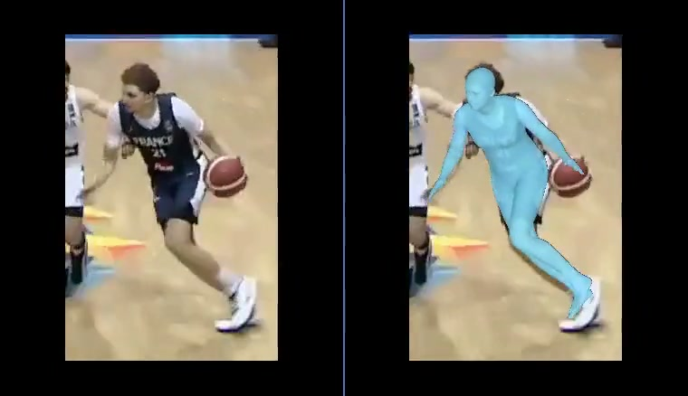
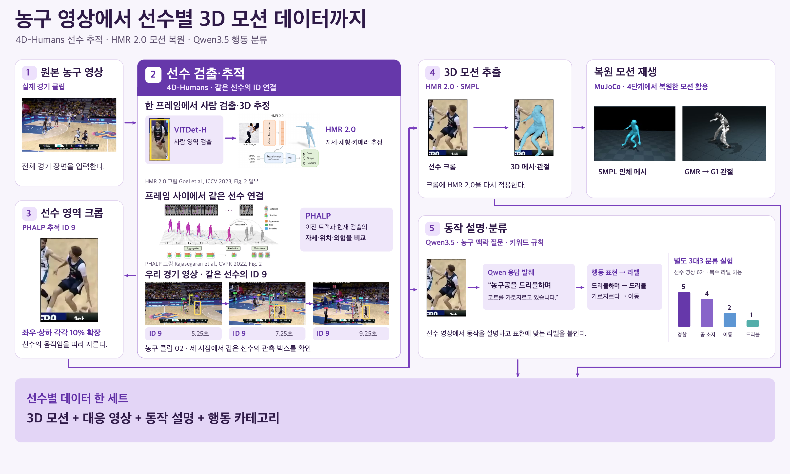
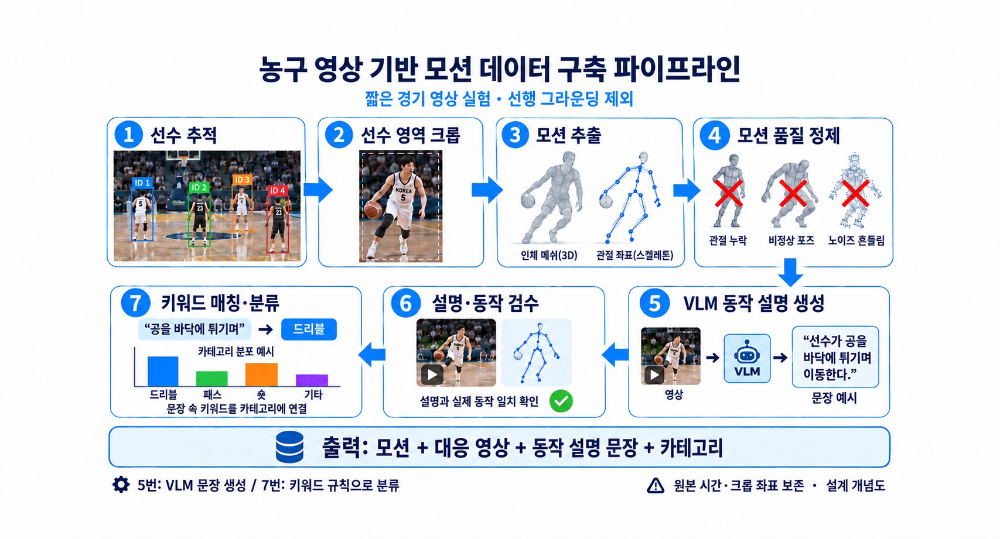

# AIM · 농구 영상에서 선수별 3D 모션 데이터까지

단국대학교 캡스톤디자인 2 · 박지우 · 박주희 · 안균승

농구 경기 영상에서 같은 선수를 추적하고, **선수 영상·3D 모션·행동 설명·카테고리**를 원본 시각과 추적 ID로 연결합니다. 복원된 인체 동작을 MuJoCo에서 확인하고, GMR로 Unitree G1 관절에 옮겨 재생과 물리 추종을 실험했습니다.

[](https://jiwoo1105.github.io/jiwoo-portfolio/projects/video-motion.html#demo)

## 제출 자료

| 제출 항목 | 자료 |
| --- | --- |
| 소스 코드 · 실행 스크립트 · 개발 문서 | [실행 방법](#실행-방법) · [농구 추적·복원 실행](mesh_recovery/basketball/README.md) · [모델 환경 설정](docs/ELICE_GUIDE.md) |
| 발표자료 또는 포스터 PDF | 최종본 준비 중 |
| 프로젝트 결과보고서 PDF | [AIM 프로젝트 결과보고서](docs/AIM-result-report.pdf) |
| 외부에서 접속 가능한 최종 시연 영상 | 녹화 및 공개 링크 준비 중 |

## 구현 결과

| 확인할 장면 | 결과 영상 |
| --- | --- |
| 같은 선수와 같은 시각의 RGB 크롭, HMR 2.0 메시, MuJoCo 인체 메시 | [6초 동기화 비교](https://raw.githubusercontent.com/DKU-AIM/video-motion-pipeline/main/docs/media/rgb-smpl-mujoco.mp4) |
| GMR로 변환한 G1 관절 목표 | [MuJoCo 기구학 재생](https://raw.githubusercontent.com/DKU-AIM/video-motion-pipeline/main/docs/media/g1-replay.mp4) |
| RGB, 보정된 관절 목표, 물리 실행 비교 | [전신 추종 실험 영상](https://raw.githubusercontent.com/DKU-AIM/video-motion-pipeline/main/docs/media/g1-fullbody.mp4) |
| 원본·추적·크롭·메시·인체 및 G1 재생 | [포트폴리오에서 단계별 재생](https://jiwoo1105.github.io/jiwoo-portfolio/projects/video-motion.html#demo) |

대표 영상은 [FIBA U20 EuroBasket 2024 슬로베니아 대 프랑스 경기](https://www.youtube.com/watch?v=kXuDZJ2TT3I&t=935s)의 15:35–15:41 구간입니다. 남색 21번 선수는 이 실험에서 PHALP ID 9로 기록했습니다.

## 파이프라인



1. **선수 검출과 추적** · ViTDet-H로 사람을 검출하고 HMR 2.0에서 자세·체형·카메라를 추정합니다. PHALP가 자세·위치·외형을 비교해 프레임 사이의 ID를 연결합니다.
2. **선수 영역 크롭** · 선택한 ID의 관측 박스를 좌우·상하 각각 10% 확장합니다. 원본 프레임 번호와 크롭 좌표를 함께 기록합니다.
3. **3D 모션 복원** · 선수 크롭에 HMR 2.0을 다시 실행해 SMPL 파라미터와 메시·관절을 저장합니다.
4. **설명과 분류** · 같은 선수의 RGB 영상에 농구 맥락을 포함한 질문을 넣어 Qwen이 설명을 생성합니다. 규칙 기반 분류기는 문장에서 행동 표현을 찾아 복수 라벨과 근거 구문을 기록합니다.
5. **선수별 데이터 연결** · 영상·3D 모션·설명·카테고리를 원본 시각과 선수 ID에 맞춰 묶습니다. 3D 모션은 별도로 MuJoCo 재생과 G1 관절 변환에 사용합니다.

<details>
<summary>초기 설계와 실험 순서 보기</summary>



- **9월** · 자연어 쿼리로 시간 구간을 먼저 찾는 설계에서 출발했습니다. [초기 설계 기록](docs/early-research-plan.md)
- **10월 초** · 농구 FPS·질의 변경과 축구 특화 모델을 시험했습니다. 짧은 농구 동작의 구간을 안정적으로 잡기 어려워, 선택한 짧은 영상에서 선수 추적과 크롭을 먼저 수행하는 방식으로 바꿨습니다.
- **10월 중순** · CoMotion과 Multi-HMR 2의 가림 후 ID 끊김과 자세 흔들림 사례를 검토했습니다. 선택한 경기에는 4D-Humans를 적용했고, 선수 크롭에서 HMR 2.0을 다시 실행했습니다.
- **11월** · 선수별 Qwen 설명과 규칙 분류를 연결하고, SMPL 및 G1의 MuJoCo 재생과 물리 추종을 시험했습니다.

</details>

## 실험에서 확인한 범위

- **농구 영상** · 검수한 5명의 6구간에서 선수 크롭과 SMPL을 연결했습니다. 대표 드리블 구간은 60 FPS, 360프레임입니다. 추적 평가는 선택 구간의 화면과 로그를 확인하는 방식이었습니다.
- **행동 분류** · 별도 3대3 경기의 선수 영상 6개에서 경합 5, 공 소지 4, 이동 2, 드리블 1을 기록했습니다. 한 영상에 여러 라벨을 허용한 출력 집계입니다.
- **MuJoCo** · 저장한 SMPL 정점을 고정 루트로 재생했습니다. GMR로 변환한 G1 29관절은 기구학적 목표 재생으로 확인했습니다.
- **G1 물리 제어** · 대표 전신 드리블의 평가 10회에서 결합 기준 통과는 0회였습니다. 하체와 허리에 기본 서기 목표를 준 팔 중심 3초 과제는 동일 참조 모션의 초기 교란 10회에서 통과했고 팔 RMSE는 평균 0.162 rad였습니다. 실험 범위는 시뮬레이션의 해당 참조 모션입니다.

## 실행 방법

실험별 코드가 들어 있습니다. 공개 샘플로 캡션에서 라벨을 만드는 단계를 모델 설치 없이 확인할 수 있습니다.

```bash
git clone https://github.com/DKU-AIM/video-motion-pipeline.git
cd video-motion-pipeline
python3 annotation/video_captioning/classify.py examples/captions.jsonl outputs/caption-labels
```

결과는 `matches.json`과 `counts.csv`에 저장됩니다.

| 경로 | 용도 |
| --- | --- |
| [grounding/](grounding/) | 초기 시간 구간 탐색 모델 실험 |
| [mesh_recovery/](mesh_recovery/) · [smpl_eval/](smpl_eval/) | 복원 비교와 검수 코드 |
| [annotation/](annotation/) | 영상 설명 분류와 모션 캡셔닝 비교 |
| [docs/](docs/) | 결과보고서, 구현 이미지, 영상과 개발 문서 |

GPU 추론에는 단계별 체크포인트와 SMPL 자산이 필요합니다. [설치 및 검증 가이드](docs/ELICE_GUIDE.md)
